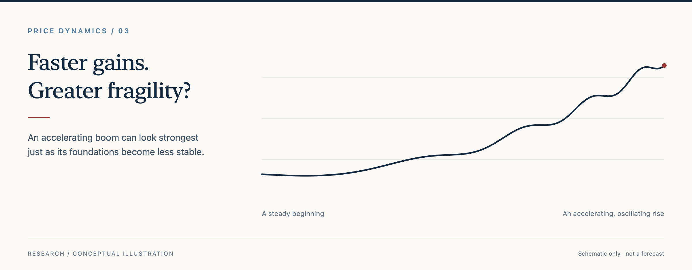
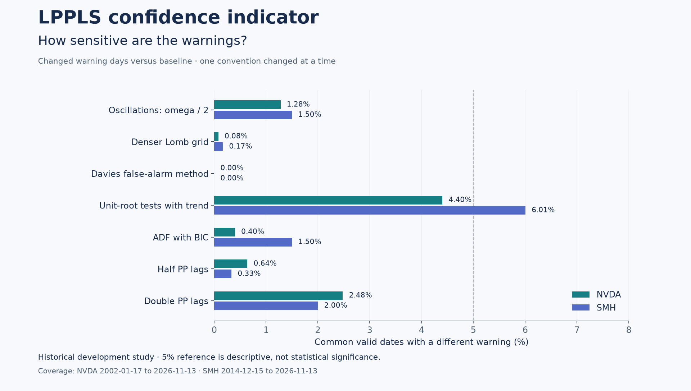
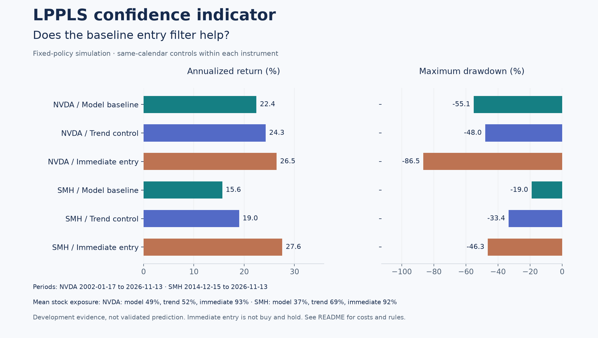

# LPPLS confidence indicator

*Does this price rise resemble an increasingly unstable boom?*

*Could an increasingly rapid price rise be making the stock more vulnerable to a sharp reversal?*



Standalone Python research implementation with independent numerical fixtures
and explicit replication questions for the paper authors.

**Replication work in progress.** Not author-endorsed, not a reproduction of
the original empirical results, and not a validated trading or forecasting system.
Unspecified settings remain declared conventions.

## Run locally

Python 3.12 and [uv](https://docs.astral.sh/uv/) are used for the checked setup.

```sh
git clone https://github.com/schmittsfn/lppls-confidence-indicator.git
cd lppls-confidence-indicator
uv sync --locked
uv run --no-sync python -m unittest discover -s tests -v
uv run --no-sync python examples/synthetic.py
```

The example fits one synthetic window. The full 141-window ensemble is available as `fit_lppls`; the example is not ensemble confidence.
Inputs are generated locally; no download or credential is needed.

## Source and implementation

Implementation: [`src/lppls_confidence_indicator/__init__.py`](src/lppls_confidence_indicator/__init__.py). Tests:
[`test_lppls.py`](tests/test_lppls.py).

Sources:
- Shu and Zhu, *Detection of Chinese Stock Market Bubbles with LPPLS Confidence
  Indicator*, [arXiv:1905.09640v2](https://arxiv.org/abs/1905.09640v2), sections 2.2–2.3.
- Filimonov and Sornette, calibration equations 13–17,
  [arXiv:1108.0099](https://arxiv.org/abs/1108.0099).

`fit_lppls(close)` accepts positive, finite, ordered daily prices indexed by
date. Supply contiguous trading sessions; the function uses observation
positions as trading time and does not infer a market calendar.

The full ensemble has 141 spans from 750 down to 50, step 5. Including both
endpoints means 751 through 51 observations. Each window uses CMA-ES with
linear least-squares variable projection, damping and residual filters, Lomb
significance, and ADF/Phillips–Perron tests. Positive and negative qualified
fractions are separate; the denominator includes all 141 attempted windows.
An iteration-budget-incomplete window makes ensemble confidence unavailable.
Failed individual windows remain in the denominator; an entirely failed
ensemble has unavailable confidence. Optimizer stopping is not proof of a
global optimum, despite the inherited `converged_windows` field name.

Unresolved source conflict: page 9 of v2 appears to print omega/2; page 10 uses
omega/pi and describes half-periods. This implementation follows omega/pi.
The journal version's possible corrections have not been verified.

Declared numerical choices include population 16, sigma 0.2, maxiter 2000,
seed 137+span; Astropy floating-mean Lomb–Scargle, angular frequencies 1–50,
five samples/peak and Baluev false-alarm approximation; ADF constant/AIC and PP
constant with floor(12*(n/100)^0.25) lag rule. These are implementation choices,
not a claim that the authors used those exact settings.

Confidence is a fraction of qualifying fits, **not a crash probability**.
Neither a zero reading nor a high reading establishes a future outcome.

## Example research results

The graphics below summarize a separate convention-sensitivity study completed
on 15 November 2026. They are **historical development results**, not the paper's
results, an untouched holdout test, or a backtest reproduced by this standalone
package. The study's baseline warnings matched its earlier archived baseline.
Alternative-convention execution and the entry evaluator live in the separate
research harness; this repository's API has not been expanded by these figures.



*Most tested settings leave the warnings largely unchanged, but some alter enough decisions to matter. These percentages describe how much the answers change—not the chance of a crash.*

Changing one convention at a time can change a warning without establishing
which convention is correct. Percentages use each alternative's common valid
dates; counts and dates are in [the plotted data](docs/results/summary.json).
The dashed 5% line is a predeclared descriptive marker, not a significance test.



*For NVIDIA, the simple trend rule earned more and suffered a smaller worst decline. For the semiconductor fund, the model reduced the worst decline but earned less and kept much more money in cash. The extra protection came with a cost.*

Each instrument uses its own period shown in the graphic. Compare policies
within an instrument, not returns across instruments or repositories. Lower
drawdown can reflect spending more time in cash. The model baseline underperformed
the trend control's annualized return on the NVIDIA calendar.

Diagnostics reuse all archived five-session fits; warnings are held until the next reading. These plots exclude the separate annual-sampled optimizer checks. Confidence is a fraction of qualified fits, not a crash probability.

**Entry experiment:** three funded sleeves; opportunities every 21 sessions;
next-open execution; fixed 60-session exit; at most 20 sessions waiting; 10 basis
points per side; historical Treasury cash proxy. “Immediate” uses that same
schedule and is **not buy and hold**. “Trend” uses the combined 50/200-day rule.
No taxes or investor-specific costs. Previously inspected, retrospectively
reconstructed history; no complete point-in-time vintages. No forecast or
trading-validity claim follows.

Figures contain aggregate research outputs only, not market-data captures or
personal portfolio information. Re-render these exact summary graphics with:

```sh
uv run --with matplotlib python examples/render_results.py
```

This renders [summary.json](docs/results/summary.json); it does not rerun or
independently reproduce the underlying historical study. The JSON records the
frozen protocol hash and comparison identity for provenance.

## Replication and contributions

See [open questions](docs/REPLICATION_QUESTIONS.md),
[verification scope](docs/VERIFICATION.md) and [provenance](NOTICE.md).
For a correction, provide the paper version, equation/page, and a minimal
reference input/output or failing test. See [CONTRIBUTING.md](CONTRIBUTING.md).

This repository contains only this model. It does not require the other risk
model repositories or the earlier combined package. No private data, portfolio
records, market captures or paper PDFs are distributed. Callers supply their
own appropriately licensed data. Original-paper empirical results have not
been reproduced here.

Code, tests and documentation were prepared with OpenAI Codex assistance.
MIT license covers this project's files; dependencies and papers retain their
respective licenses and rights. No independent academic audit is claimed.

CMA may warn that optional plotting is unavailable because matplotlib is not
installed. The numerical implementation and tests do not require plotting.

## Rebuild the introductory illustration

The introductory graphic is drawn locally with SwiftUI and exported with
`ImageRenderer`. It is schematic, not observed market data. No image service,
API key or paid generation is used. On macOS with Xcode command-line tools:

```sh
swiftc -parse-as-library examples/hero/HeroView.swift examples/hero/Export.swift -o /tmp/render-risk-hero
/tmp/render-risk-hero docs/hero/concept.png
```

The export is a 2400 × 940 PNG. Source: [HeroView.swift](examples/hero/HeroView.swift).
